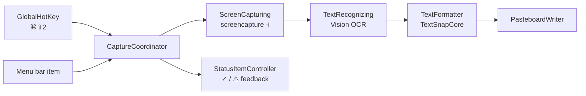

# Architecture

TextSnap is split into two Swift modules with a strict dependency direction:

| Module | Depends on | Responsibility |
| --- | --- | --- |
| `TextSnapCore` | Foundation only | Turns OCR lines into structured text. Pure, deterministic, fully unit tested. |
| `TextSnap` | AppKit, Vision, Carbon, ServiceManagement, `TextSnapCore` | Everything that touches macOS: hotkey, capture, OCR, clipboard, menu bar, login item. |

The core never imports AppKit or Vision, so the hardest logic (layout reconstruction) runs in tests in milliseconds, with no screen or permission needed.

## Capture pipeline



`CaptureCoordinator` owns the flow and runs one capture at a time; pressing the hotkey again while a capture is in progress does nothing. Capture and recognition sit behind protocols (`ScreenCapturing`, `TextRecognizing`), so either one can be swapped or faked without touching the rest.

## Layout reconstruction (`TextSnapCore`)

```
[TextLine] ──RowAssembler──▶ rows ──LayoutAnalyzer──▶ Document ──Renderer──▶ String
```

1. **`RowAssembler`** merges OCR fragments that share a visual row (for example a bold prefix that Vision returns separately) and sorts rows top to bottom. Wide horizontal gaps are kept as runs of spaces.
2. **`LayoutAnalyzer`** makes a single forward pass and classifies each row:
   - **Heading**: noticeably taller than the body text (≥ 1.6× → `#`, ≥ 1.3× → `##`).
   - **List item**: starts with a bullet glyph (`•`, `◦`, `▪`, `-`, `*`, …) or an ordered marker (`1.`, `2)`, `a)`).
   - **Continuation**: a row without a marker, indented past the previous item's bullet and close below it, gets appended to that item.
   - **Paragraph**: other rows. Soft-wrapped lines are joined; a line break is kept only when the next word would have fit on the previous line.
   - **Nesting**: list markers are grouped into indentation stops, and each stop becomes one nesting level.
3. **`MarkdownRenderer` / `PlainTextRenderer`** serialize the `Document`. Blocks are separated by a blank line.

All thresholds are relative to the median line height, so the same rules work on a Retina capture and on a small screenshot. The tuning values live in `LayoutAnalyzer.Tuning`.

## macOS shell (`TextSnap`)

| Folder | Contents |
| --- | --- |
| `App/` | `main.swift`, `AppDelegate` (composition root, builds the object graph once), `CaptureCoordinator` |
| `Capture/` | `InteractiveScreenshotCapturer` (drives `/usr/sbin/screencapture -i`, so the selection UI is the system one), screen recording permission check |
| `Recognition/` | `VisionTextRecognizer` (`RecognizeTextRequest`, accurate level, language correction, automatic language detection) |
| `System/` | Carbon global hotkey, `SMAppService` login item, pasteboard, `UserDefaults` preferences, `os.Logger` categories |
| `UI/` | `StatusItemController`: menu bar icon, menu, success/failure feedback |

## Performance and resource use

- **Idle cost is zero.** The hotkey uses Carbon's `RegisterEventHotKey`: the window server wakes the app only when the shortcut is pressed. There is no polling, no event tap and no Accessibility permission. The app also has no timers and no windows.
- **No Dock icon.** `LSUIElement` keeps the app in the menu bar only.
- **Work stays off the main thread.** Image decoding and OCR are `@concurrent`, so the menu bar never freezes.
- **Images are short-lived.** The screenshot goes to a temporary PNG, which is decoded eagerly into memory and deleted right away.
- **Swift 6 language mode** with strict concurrency checking. UI types are `@MainActor`; everything shared across threads is `Sendable`.

## Code signing and permissions

macOS ties the Screen Recording grant to the app's *designated requirement*. An ad-hoc signature embeds the binary hash, so every rebuild looks like a new app and loses the grant, even though the toggle in System Settings stays on. `scripts/setup-signing.sh` creates a self-signed certificate once. That makes the requirement `identifier "com.andreponce.TextSnap" and certificate leaf = H"…"`, which stays the same across builds.
